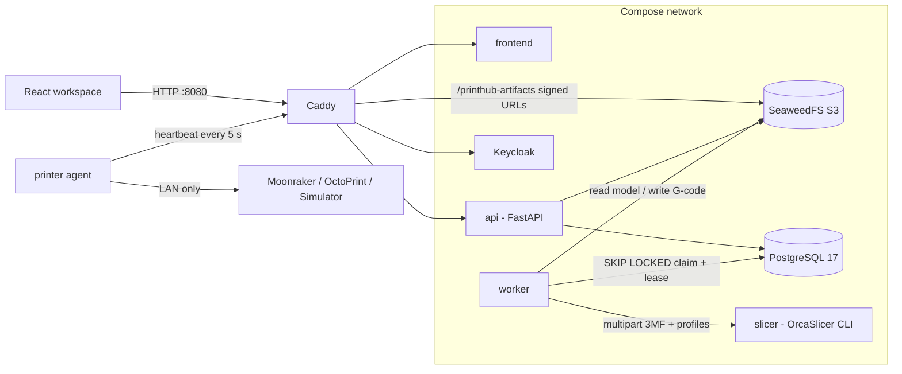

# Architecture

## Overview

Only Caddy is published to the network. PostgreSQL is also bound to `127.0.0.1:5433` for local tools. The slicer has no route through Caddy.

## Components

| Component | Code | Does | Does not |
| --- | --- | --- | --- |
| Workspace | `Frontend/src` | UI, 3D editing, 3MF packaging, G-code parsing in a Web Worker, PKCE login | Touch the database or hold storage credentials |
| API | `Backend/app/main.py`, `slicing_routes.py`, `workspace_routes.py` | Verify JWTs, enforce ownership, issue signed URLs, create jobs, queue printer commands | Stream model uploads through itself |
| Worker | `Backend/app/worker.py` | Claim tasks, verify model checksum, call slicer, store G-code + SHA-256, retry / dead-letter | Accept HTTP requests |
| Slicer | `Deployments/self-hosted/slicer/printhub-server.mjs` | Run one isolated Orca CLI process per request; one slice at a time; cancel on request | Authenticate callers (it is private) |
| Agent | `Backend/app/printer_agent.py` | Poll for commands, verify G-code, drive the printer host, report telemetry | Open inbound ports or reach the database |
| Keycloak | `Deployments/self-hosted/keycloak/printhub-realm.json` | Login and token issue | Store application data |

## Slice flow

1. Browser calls `POST /files/upload-url` with name, size and SHA-256. API returns a 10-minute S3 SigV4 URL.
2. Browser `PUT`s the 3MF/STL to `/printhub-artifacts/...`. Caddy forwards it to SeaweedFS.
3. Browser calls `POST /files/{id}/complete`. API checks the object size and marks the file `ready`.
4. Browser calls `POST /slice-jobs` with an `Idempotency-Key`. API pins exact profile versions and inserts a `queued` task.
5. Worker claims the task with `FOR UPDATE SKIP LOCKED`, sets a 90 s lease and renews it while slicing.
6. Worker checks the model SHA-256, sends it to the slicer, stores the G-code and its SHA-256, and marks the job `completed`.
7. Browser polls the job (every 1.5 s) and loads the G-code into the preview.

Failures retry after `5 s × 2^(attempt-1)`, capped at 300 s. After 5 attempts the task is `dead-lettered`. An expired lease lets another worker reclaim the task.

## Print flow

1. User requests a pairing code. The API stores only its SHA-256 hash.
2. Agent redeems the code at `POST /agent/pair` and receives a long-lived token. The API stores only the token's SHA-256 hash.
3. Every 5 s the agent posts `POST /agent/heartbeat` with state and telemetry. The response carries at most one queued command, now marked `delivered`.
4. For a print, the command includes a 5-minute signed G-code URL and the expected SHA-256.
5. Agent downloads, verifies, uploads to the printer host, verifies the host copy, starts the print, and acknowledges `completed` or `failed`.

The dashboard polls printers and jobs every 4 s. There is no SSE or WebSocket channel.

## Security

- Browser login uses Authorization Code + PKCE (S256). Passwords go only to Keycloak.
- The API checks RS256 signature (JWKS), issuer, expiry and subject; audience when `OIDC_AUDIENCE` is set.
- Every query filters by the token subject. Another user's resource returns `404`.
- Large files move through short-lived signed URLs scoped to one object key.
- Pairing codes are 192-bit random, single-use, 10-minute. Agent tokens are 384-bit random. Only hashes are stored.
- G-code is checksummed before and after transfer to the printer host.
- The stack runs over plain HTTP. Put TLS in front of Caddy before using it beyond localhost.

## Failure handling

| Failure | Handling |
| --- | --- |
| Worker dies mid-slice | Lease expires; another worker reclaims; final-attempt expiry is dead-lettered |
| Slicer down or errors | Exponential retry, then `dead-lettered` with the error stored |
| Duplicate slice request | `Idempotency-Key` returns the original job; different body returns `409` |
| Concurrent workers | Row locks with `SKIP LOCKED`; covered by `test_postgres_queue.py` |
| Corrupted G-code | SHA-256 mismatch makes the agent refuse to print |
| Agent offline | Printer shows `offline` after 45 s; new commands are rejected |
| Agent crash after delivery | Command is not replayed, to avoid a double print |
| Database or storage down | `/health/ready` returns `503` naming the failed check |

## Not yet built

- Storage retention and cleanup jobs.
- Metrics, tracing, alerts.
- CI/CD and automated backups.
- Rate limiting on pairing.
- AWS deployment ([plan](aws.md)).